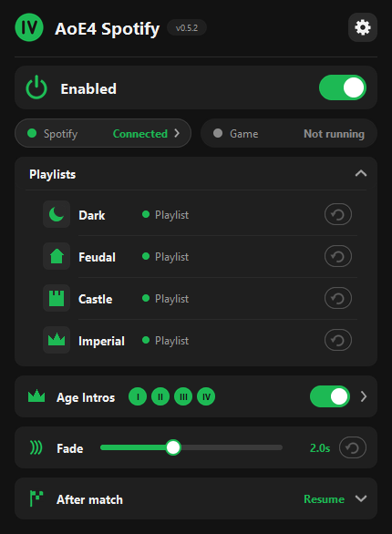
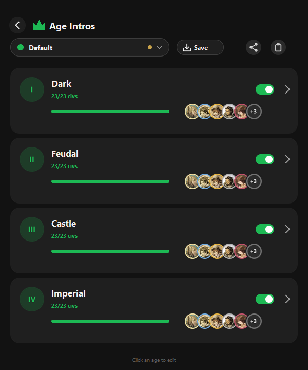
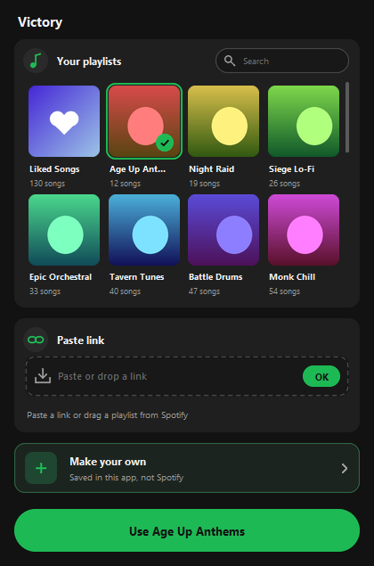

<picture><source media="(prefers-color-scheme: dark)" srcset="assets/title-dark.svg"></picture>

Spotify music that follows your ages in **Age of Empires IV**.

&nbsp;&nbsp;Latest · Windows 10/11 · <a href="https://github.com/Capstar1/aoe4-spotify/releases">all releases</a>

 

  &nbsp;
  &nbsp;
  

## Features

- **Age playlists:** a playlist for Dark, Feudal, Castle and Imperial Age, switched with a smooth fade when you age up.
- **Age intros:** a short civ-themed song when you reach a new age.
- **After match:** resume your own music, play a playlist, or stop, with an optional victory or defeat song first.
- **Your playlists:** pick from your Liked Songs and Spotify playlists, or make your own in the app with drag and drop.
- **Stays out of your way:** pausing Spotify holds the switching, works in AI games, and your shuffle and repeat settings come back afterwards.

## Requirements

- Windows 10/11 and Age of Empires IV on **Steam**.
- **Spotify Premium** and the Spotify desktop app.
- Access to the app's Spotify login. New users can request a seat from the app (approved by hand), or use their own Spotify app from the gear menu.

## Install

1. Download the installer with the button above.
2. Run it. If Windows warns you, choose *More info -> Run anyway*. No admin rights needed.
3. If Steam is open, Setup closes it briefly and reopens it, so AoE4 starts the app with the game.
4. At the end, leave *Log in to Spotify now* ticked, log in and click Agree.

Then start AoE4 from Steam as usual. New versions install from the green *Update* button in the app.

Uninstall from the app's gear menu or *Settings -> Apps -> Installed apps*. Your Steam settings are put back.

## Privacy

Your Spotify login stays on your PC. The app only reads the game's own log file and runs only while you play.

## Build from source

See [build.md](build.md).

## Credits

Made by Capstar, built with Grok Bot. Original idea by **WujuWarrior**, the reason this project exists.

- Civ flag icons from [aoe4world/overlay](https://github.com/aoe4world/overlay).
- Character portraits and the *For ...* themes are from OCTOPATH TRAVELER (music is played through Spotify, not included).

Age of Empires IV is a trademark of Microsoft / World's Edge. OCTOPATH TRAVELER is a trademark of Square Enix. This is an unofficial, non-commercial fan project, not affiliated with or endorsed by either.

## License

MIT for the code, see [LICENSE](LICENSE). Game and character art belong to their owners.